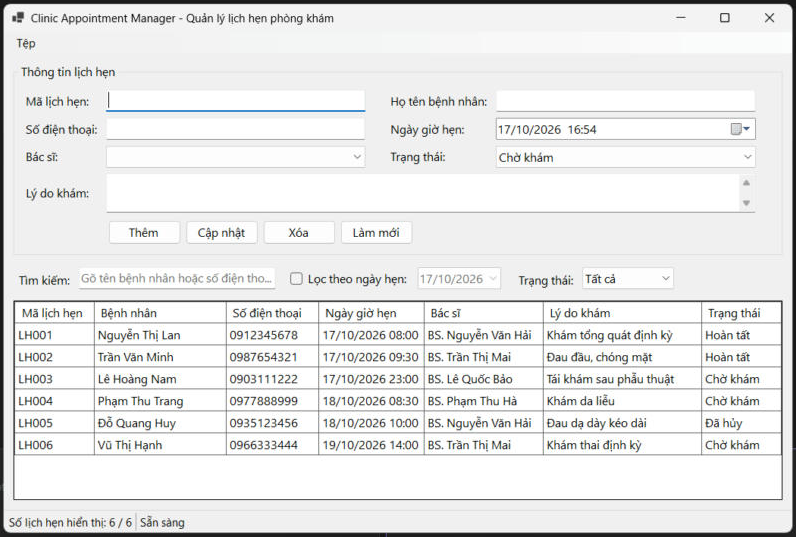
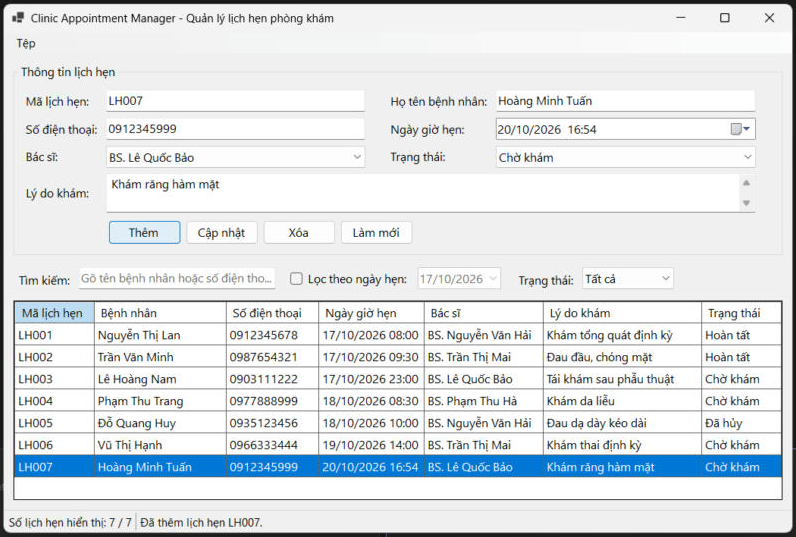
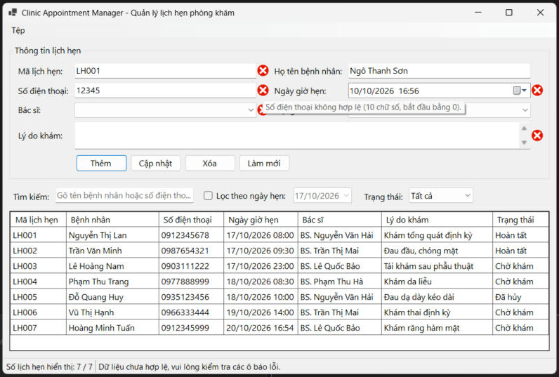
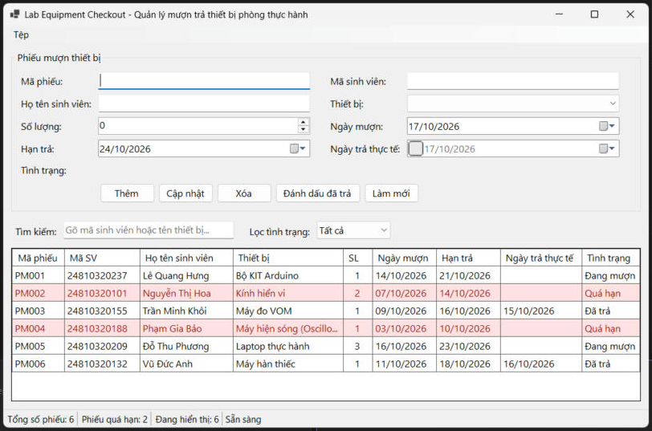
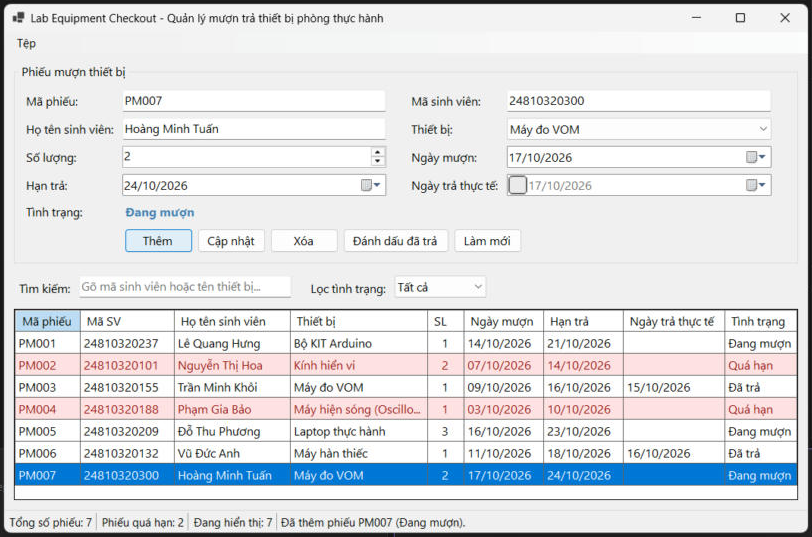
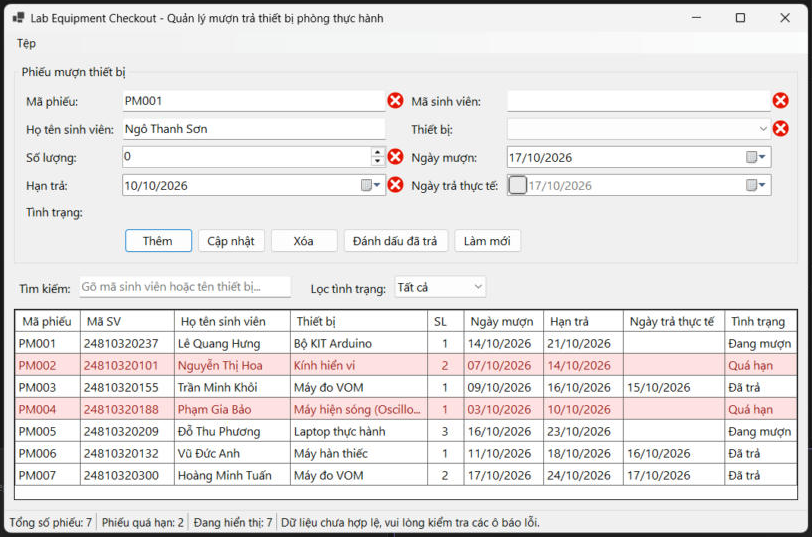
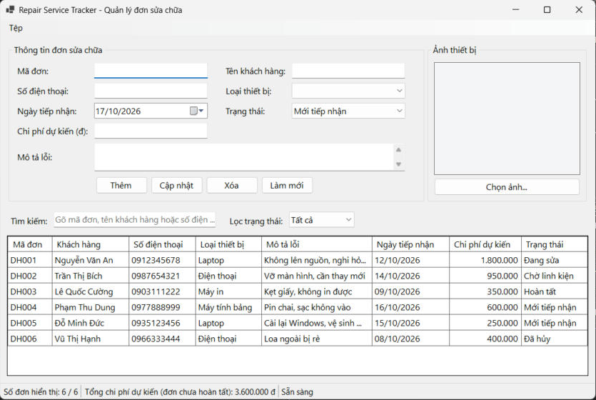
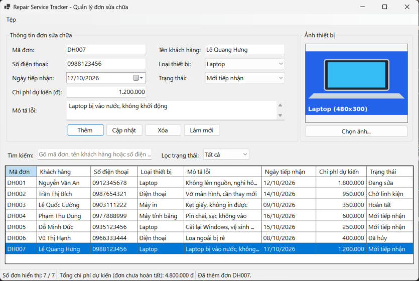
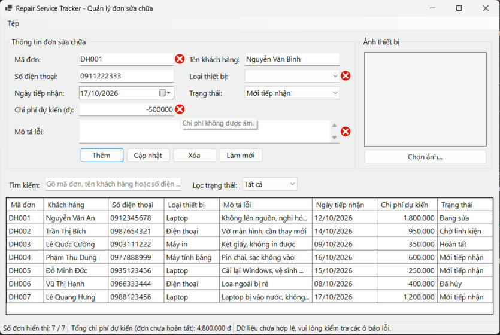

# BÁO CÁO BÀI TẬP / ĐỒ ÁN

## THÔNG TIN SINH VIÊN
- **Họ và tên:** Lê Quang Hưng
- **Mã số sinh viên:** 24810320237
- **Lớp:** d19qtanm1
- **Tên môn học:** Lập trình .NET (C# / Windows Forms)
- **Tên bài tập:** Bài 1, Bài 2, Bài 3

## CẤU TRÚC DỰ ÁN

Mỗi bài nằm trong thư mục riêng, có file solution riêng (ví dụ `bai1/bai1.slnx`), project Windows Forms (.NET 10):

| Thư mục / Solution | Nội dung |
|---|---|
| `bai1/bai1.slnx` | Clinic Appointment Manager: quản lý lịch hẹn phòng khám (`TableLayoutPanel`, `DataGridView`, `BindingSource`, `ErrorProvider`, xuất CSV) |
| `bai2/bai2.slnx` | Lab Equipment Checkout: quản lý mượn trả thiết bị (phát hiện quá hạn, đánh dấu đã trả, `StatusStrip`, xuất CSV) |
| `bai3/bai3.slnx` | Repair Service Tracker: quản lý đơn sửa chữa (`PictureBox` Zoom, `OpenFileDialog`, định dạng chi phí "N0", tổng chi phí trên `StatusStrip`) |

---

## KẾT QUẢ THỰC HÀNH

## Bài 1: Quản lý lịch hẹn phòng khám (Clinic Appointment Manager)

### 1. Ảnh màn hình Giao diện chính (chưa nhập dữ liệu)

*Vừa chạy chương trình: bảng lịch hẹn mẫu, các ô nhập còn trống, thanh trạng thái hiển thị số lịch hẹn đang hiển thị.*

### 2. Ảnh màn hình Nhập dữ liệu thành công

*Nhập đầy đủ thông tin hợp lệ rồi nhấn Thêm: lịch hẹn mới xuất hiện trong bảng, số lượng trên thanh trạng thái tăng lên.*

### 3. Ảnh màn hình Nhập dữ liệu báo lỗi (Validation)

*Nhập số điện thoại sai định dạng: `ErrorProvider` báo lỗi cạnh ô tương ứng, không cho lưu.*

---

## Bài 2: Quản lý mượn trả thiết bị (Lab Equipment Checkout)

### 1. Ảnh màn hình Giao diện chính (chưa nhập dữ liệu)

*Vừa chạy chương trình: danh sách phiếu mượn mẫu, phiếu quá hạn tô nền đỏ nhạt, thanh trạng thái hiển thị tổng số phiếu và số phiếu quá hạn.*

### 2. Ảnh màn hình Nhập dữ liệu thành công

*Thêm phiếu mượn hợp lệ và đánh dấu đã trả: trạng thái và ngày trả thực tế cập nhật trên bảng, số liệu trên thanh trạng thái đổi theo.*

### 3. Ảnh màn hình Nhập dữ liệu báo lỗi (Validation)

*Nhập mã phiếu trùng, số lượng 0, hạn trả trước ngày mượn, thiếu mã sinh viên và thiết bị: `ErrorProvider` báo lỗi ở từng ô, không lưu dữ liệu sai.*

---

## Bài 3: Quản lý đơn đăng ký dịch vụ sửa chữa (Repair Service Tracker)

### 1. Ảnh màn hình Giao diện chính (chưa nhập dữ liệu)

*Vừa chạy chương trình: danh sách đơn mẫu, chi phí định dạng "N0", thanh trạng thái hiển thị số đơn và tổng chi phí dự kiến của các đơn chưa hoàn tất (3.600.000 đ).*

### 2. Ảnh màn hình Nhập dữ liệu thành công

*Nhập đơn DH007, chọn ảnh thiết bị (hiển thị đúng tỷ lệ với `PictureBoxSizeMode.Zoom`) rồi nhấn Thêm: đơn xuất hiện trong bảng, tổng chi phí tăng lên 4.800.000 đ.*

### 3. Ảnh màn hình Nhập dữ liệu báo lỗi (Validation)

*Nhập mã đơn trùng, chi phí âm (-500000), thiếu mô tả lỗi và loại thiết bị: `ErrorProvider` báo lỗi (ví dụ "Chi phí không được âm."), không cho lưu.*
